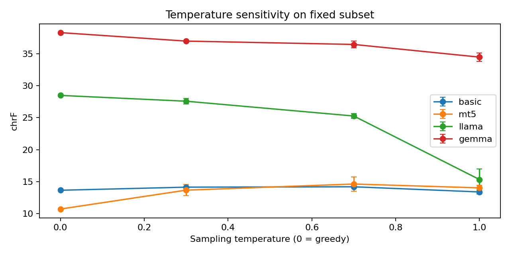
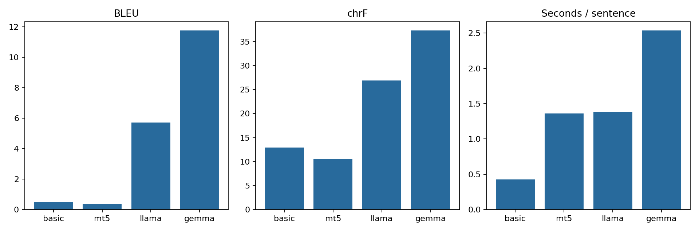
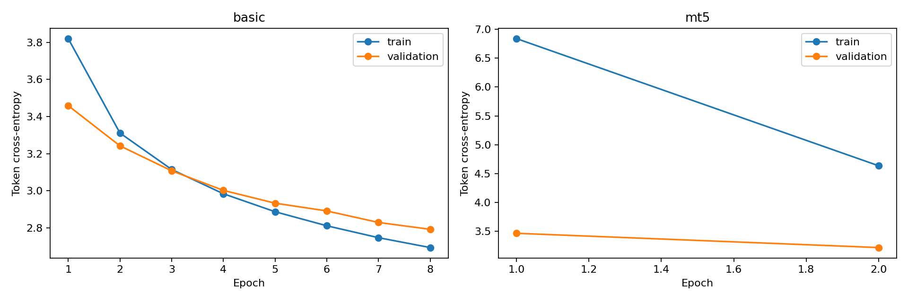

# Measured experiment report

Status: All four primary model runs available.

Dataset revision: `321516f50bdcc1214fa75164c545478976ed84bd`. Test fingerprint: `277e8288e56ba73a6015ebb92ce3cea16b728f997622438cfa853db2ffff73b4`.

| Model | BLEU | chrF | Training seconds | Inference seconds | Parameters |
|---|---:|---:|---:|---:|---:|
| basic | 0.49 | 12.91 | 23263.0 | 128.53 | 6,195,776 |
| mt5 | 0.35 | 10.54 | 2013.0 | 407.58 | 300,520,832 |
| llama | 5.71 | 26.94 | N/A (prompting) | 414.57 | 1,235,814,400 |
| gemma | 11.76 | 37.31 | N/A (prompting) | 760.44 | 999,885,952 |

Best measured model by predeclared primary metric chrF (BLEU breaks ties): **gemma**.
This ranking applies only to this subset and protocol; no significance test or universal superiority is claimed.

## Interpretation

Compare BLEU and chrF together. chrF is the primary ranking metric because character overlap is useful for Hindi morphology. The scratch Transformer learns translation and representations only from this training subset; mT5 adapts multilingual pretrained representations; LLaMA and Gemma use instruction pretraining and zero-shot prompting. Size, tokenizer, pretraining and adaptation differ, so this is not a controlled architecture ablation.

Inference uses batch size one, greedy decoding, one beam and the same output token cap. Tokens differ by tokenizer; decoder prompts add input overhead. Timing excludes loading and warmup but includes tokenization, generation and decoding, with CUDA synchronization. Training includes validation and checkpoint saves, excludes initial model/tokenizer loading, and uses the best validation-loss checkpoint. Prompting has no training time (N/A). Peak CUDA allocation covers only the current invocation: it includes training only if training occurred in that invocation. A reused checkpoint reports inference allocation only. It excludes non-PyTorch/display allocations. Review truncation and output-cap counts before comparing quality. Different devices invalidate direct speed comparisons.

## Sampling-temperature analysis

Same fixed test subset at each temperature. Positive temperatures use three seeds; report population standard deviation. Temperature zero is greedy and has one run. Sampling uses the full distribution (top-p=1, top-k=0 for HF models); temperature changes output diversity, not model weights. Do not select checkpoints or tune temperatures against this test set.

| Model | Temperature | Runs | BLEU mean ± SD | chrF mean ± SD |
|---|---:|---:|---:|---:|
| basic | 0 | 1 | 0.65 ± 0.00 | 13.66 ± 0.00 |
| basic | 0.3 | 3 | 0.52 ± 0.09 | 14.14 ± 0.12 |
| basic | 0.7 | 3 | 0.52 ± 0.09 | 14.20 ± 0.16 |
| basic | 1 | 3 | 0.33 ± 0.04 | 13.40 ± 0.30 |
| mt5 | 0 | 1 | 0.40 ± 0.00 | 10.73 ± 0.00 |
| mt5 | 0.3 | 3 | 0.66 ± 0.37 | 13.68 ± 0.89 |
| mt5 | 0.7 | 3 | 0.78 ± 0.33 | 14.64 ± 1.14 |
| mt5 | 1 | 3 | 0.52 ± 0.23 | 14.03 ± 0.43 |
| llama | 0 | 1 | 5.38 ± 0.00 | 28.48 ± 0.00 |
| llama | 0.3 | 3 | 5.29 ± 0.15 | 27.57 ± 0.46 |
| llama | 0.7 | 3 | 4.55 ± 0.29 | 25.26 ± 0.39 |
| llama | 1 | 3 | 1.01 ± 0.15 | 15.34 ± 1.66 |
| gemma | 0 | 1 | 12.90 ± 0.00 | 38.28 ± 0.00 |
| gemma | 0.3 | 3 | 12.66 ± 0.52 | 36.96 ± 0.06 |
| gemma | 0.7 | 3 | 11.50 ± 0.80 | 36.44 ± 0.52 |
| gemma | 1 | 3 | 11.14 ± 0.71 | 34.46 ± 0.63 |

## Responsible AI review

Use ethics_review.csv to inspect aligned outputs. Automated digit-change and empty-output flags are screening aids, not proof of hallucination or harm. A Hindi speaker must review gender/caste/religion stereotypes, omitted negation, invented facts, honorifics and cultural references, medical/legal uncertainty, and handling of sensitive language. Record actual source/translation evidence and a correction. Do not claim model-specific ethical findings from overlap scores alone.

Mitigations: diverse and documented training data; subgroup evaluation with adequate sample sizes; preserve names, numbers and uncertainty; human review for consequential translations; display limitations; avoid private data in public outputs; provide correction and escalation channels. Automatic translation must not be the sole basis for medical, legal, or safety decisions.

## Generated samples

See samples.html for side-by-side outputs and predictions/*.json for the full test translations.

## Completed-run analysis

After all four runs, see [comparison and conclusion](ANALYSIS.md), [qualitative review](QUALITATIVE_REVIEW.md), and [score verification](verification.json).
